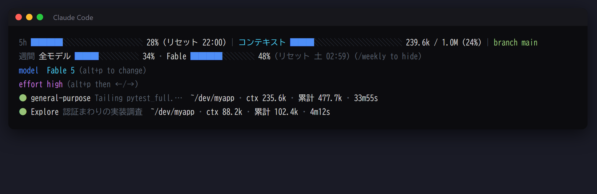

# claude-code-statusline

Claude Code のステータスラインを多段表示にカスタマイズする Python スクリプト。使用率・コンテキスト・gitブランチ・モデル/エフォート・稼働中サブエージェントを1画面で把握できます。

A multi-line status line for [Claude Code](https://code.claude.com/docs/en/statusline): 5-hour & weekly rate limits, context window, git branch, model/effort with shortcut hints, and live subagent monitoring (working dir / context / tokens / elapsed).



## できること

- 5時間・週間の使用率、コンテキストウィンドウ、gitブランチをステータスラインに並べる
- 現在のモデルとエフォートを、変更用のショートカット（`alt+p`）と一緒に出す
- 稼働中のサブエージェントを1体1行で出し、作業ディレクトリ・コンテキスト・消費トークン・経過時間を追う
- 週間使用率の行を `/weekly` で出し入れする

### 行ごとの表示内容

| 行 | 内容 |
| --- | --- |
| 1 | **5h使用率**（バー＋リセット時刻）／ **コンテキストウィンドウ**（使用率で青→黄→赤）／ **gitブランチ** |
| 2 | **週間使用率**（全モデル＋モデル別、リセット曜日・時刻）。`/weekly` で表示ON/OFF |
| 3 | **model** 現在のモデル名（`alt+p` で変更、fast mode中は ⚡fast 表示） |
| 4 | **effort** 現在のエフォート（`alt+p` → `←`/`→` で調整） |
| 5〜 | **稼働中サブエージェント**（最大6体）: 種類・依頼内容・作業ディレクトリ・ctx（現在のコンテキストサイズ）・累計（実消費トークン）・経過時間 |

## 必要環境

- Claude Code v2.x（`context_window` / `effort` がstatusline入力に含まれるバージョン）
- Python 3.8+

## セットアップ

### 1. スクリプトを配置

`statusline.py` を `~/.claude/statusline.py` にコピーします。

```
# Windows (PowerShell)
Copy-Item statusline.py "$env:USERPROFILE\.claude\statusline.py"

# macOS / Linux
cp statusline.py ~/.claude/statusline.py
```

### 2. `~/.claude/settings.json` に statusLine を設定

```json
{
  "statusLine": {
    "type": "command",
    "command": "python \"~/.claude/statusline.py\"",
    "refreshInterval": 5
  }
}
```

> Windows ではパスをフルパスで書くのが確実です（例: `python \"C:/Users/<you>/.claude/statusline.py\"`）。
> `refreshInterval: 5` は、エージェント行や経過時間をアイドル中も5秒ごとに更新するための設定です。

### 3.（任意）`/weekly` トグルコマンド

週間使用率の行をコマンド1つで出し入れできます。

```
# トグルスクリプトを配置
cp statusline-weekly-toggle.py ~/.claude/statusline-weekly-toggle.py

# スラッシュコマンドを配置
cp commands/weekly.md ~/.claude/commands/weekly.md
```

Claude Code 内で `/weekly` と打つたびに表示がON/OFF切り替わります（実体は `~/.claude/statusline-weekly.on` フラグファイルの有無）。

## 使い方

- **モデル変更**: `alt+p`（macOSは `option+p`）でモデルピッカーが開きます
- **エフォート調整**: ピッカー内で `←` / `→`、`s` でこのセッションのみ適用
- **週間表示の切替**: `/weekly`
- **エージェント行**: `Agent` ツールでサブエージェントが起動すると自動で現れ、完了すると消えます

## 技術の詳細

### 仕組み

- 基本情報は Claude Code がstatuslineコマンドのstdinへ渡す[セッションJSON](https://code.claude.com/docs/en/statusline)（`rate_limits` / `context_window` / `model` / `effort` など）から取得
- **週間・モデル別の使用率**は Claude Code 自身のOAuthトークン（`~/.claude/.credentials.json`）で `api.anthropic.com/api/oauth/usage` を参照（5分キャッシュ・失敗時60秒バックオフ）。トークンはAnthropic APIへの認証にのみ使い、キャッシュには使用率の数値だけを保存します
- **gitブランチ**は `.git/HEAD` の直読み（サブプロセスなし。worktree / submodule / detached HEAD 対応）
- **サブエージェント**は `~/.claude/projects/<project>/<session>/subagents/` のトランスクリプトを増分スキャンし、完了判定は親トランスクリプトの完了マーカー（task-notification / tool_result）で行います。読み取り済みオフセットは `~/.claude/statusline-cache/` にキャッシュ（7日で自動掃除）

| ファイル | 役割 |
| --- | --- |
| `statusline.py` | ステータスライン本体 |
| `statusline-weekly-toggle.py` | 週間使用率の行の表示フラグを切り替える |
| `commands/weekly.md` | `/weekly` スラッシュコマンド |

### 注意

- `api/oauth/usage` は非公開エンドポイントのため、仕様変更で週間表示が動かなくなる可能性があります（その場合は statusline 入力の `seven_day`＝全モデル週間のみにフォールバックします）
- サブエージェントのトランスクリプト形式は Claude Code の内部仕様であり、将来のバージョンで変わる可能性があります（動作確認: v2.1.220）

## License

MIT
